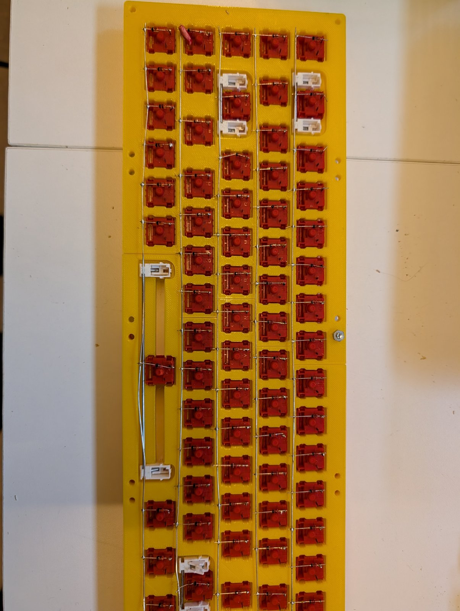
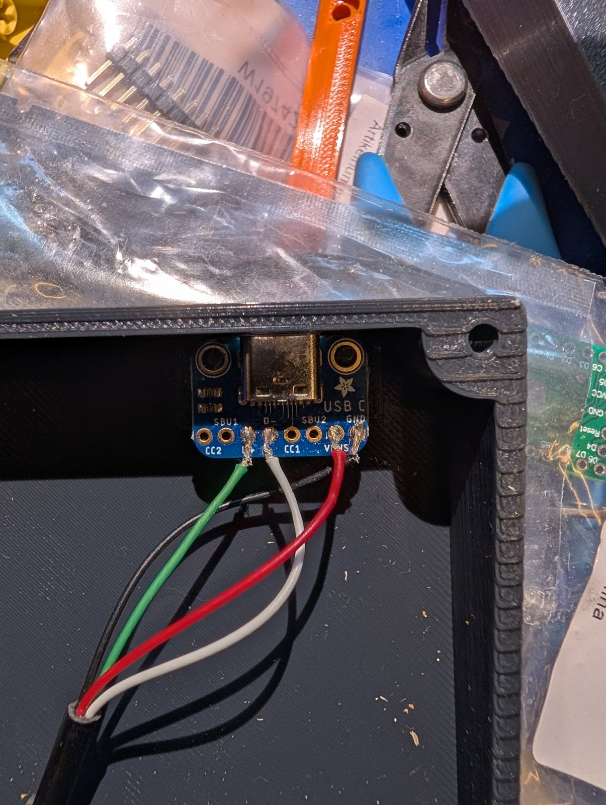

# gyrofx mml — handwired 65 % keyboard

A 68-key, 65 % ANSI keyboard with a 3D-printed case, handwired switches and a Raspberry Pi Pico running QMK. The case is the Printables model [Mechanical Keyboard - 68 Key - 65%](https://www.printables.com/model/307908-mechanical-keyboard-68-key-65) by Mad Mod Labs. The original design uses a Teensy 2.0. This build uses a Raspberry Pi Pico and its own wiring.



* Keyboard Maintainer: [gyrofx](https://github.com/gyrofx)
* Hardware Supported: Raspberry Pi Pico (RP2040)
* Hardware Availability: Handwired, case from [Printables #307908](https://www.printables.com/model/307908-mechanical-keyboard-68-key-65)

## Folder layout

| Path | Content |
|---|---|
| `keyboard.json`, `keymaps/default/` | QMK firmware (`0_gyrofx/mml`) |
| `docs/solder-plan.html` | Printable solder plan: back view with all column wires, checklist, Pico pinout |
| `docs/images/` | Photos of the build |
| `case/original/` | Original STL files and the Printables PDF |
| `case/keyboard-case.FCStd` | FreeCAD file with the modified bottom-right case part |
| `case/BottomRight-modified.3mf` | Export of the modified bottom-right part, ready to slice |

## Parts

| Qty | Part | Note |
|---|---|---|
| 1 | Raspberry Pi Pico (RP2040) | Any Pico with GP0–GP22 on the edge pins |
| 1 | USB-C breakout board | Adafruit "USB Type C Breakout", with the 5.1 kΩ CC resistors on board |
| 68 | Mechanical switches, plate mount | |
| 68 | 1N4148 diodes | |
| 3 | 2u plate-mount stabilizers | Backspace, Enter, Left Shift |
| 1 | 6.25u plate-mount stabilizer | Spacebar |
| 1 | 65 % ANSI keycap set | |
| 8 | M3 × 12 mm screws | |
| 8 | M3 × 20 mm screws | |
| 16 | M3 nuts | |
| | Bare wire for the rows, insulated or enamelled wire for the columns | Columns cross the rows |
| | Thin stranded wire (26–30 AWG) | USB data wires to the Pico |
| | Rubber feet | optional |

## 3D printing

Settings from the original model: PLA, 20 % infill, 0.2 mm layers, no supports.

| File (`case/`) | Print |
|---|---|
| `original/ANSI Plate Left.stl`, `original/ANSI Plate Right.stl` | Switch plate (ISO version: `ISOPlateTopLeft/Right.stl`) |
| `original/BezelLeft.stl`, `original/BezelRight.stl` | Top bezel |
| `original/BottomLeft.stl`, `original/BottomMiddle.stl` | Bottom case |
| `BottomRight-modified.3mf` | Bottom-right case part, **use this instead of** `original/BottomRight.stl` |

### Why the bottom-right part is modified

The bottom-right part is modified to hold the **Adafruit USB-C breakout**:

* `Pins`: two Ø 2 mm pins, 15 mm apart and 3 mm high. They go through the two mounting holes of the breakout and hold it in place, with the USB-C socket facing the opening in the case wall.
* `StretchPlusX` / `StretchMinusX`: the mount is extended by 5 mm in +X and −X, to make room for the breakout.

To change it, open `case/keyboard-case.FCStd` in FreeCAD. The `Body` is built on the original `BottomRight.stl` mesh (converted to the solid `BottomRight_Solid`), with the two stretch pads and the `PinSketch` → `Pins` pad on top. Export the `Body` as 3MF or STL to print it.

## Assembly

1. Print all parts. Join the two plate halves.
2. Clip in the stabilizers **before** the switches: 2u for Backspace, Enter and Left Shift, 6.25u for the spacebar.
3. Insert all 68 switches into the plate.
4. Solder a diode to one pin of each switch, then solder the rows (below).
5. Solder the 16 column wires to the other pin of each switch (below).
6. Wire the rows and columns to the Pico. Put the USB-C breakout on the pins in the bottom-right case part and solder it to the Pico (see [USB-C](#usb-c)).
7. Flash the firmware (see [Flashing the Pico](#flashing-the-pico)).
8. Test every key **before** closing the case.
9. Mount the plate, bezel and bottom with the M3 screws.

## Matrix

5 rows × 16 columns, `COL2ROW`: the current flows from the column, through the switch and the diode, into the row.

```
 column wire ── switch ── diode ──|<── row wire
                          (stripe / cathode towards the row)
```

* **Rows**: the diode's cathode (striped end) goes to the row wire. One row wire per physical key row. The row wires can be bare wire.
* **Columns**: wired to the free switch pin (the pin without the diode). **Use insulated wire**, because each column crosses every row wire.

The columns follow the staggered key layout. Some skip a row. Wire exactly these keys together:

| Column | Pico | Row 0 (numbers) | Row 1 (Tab) | Row 2 (Caps) | Row 3 (Shift) | Row 4 (Space) |
|---|---|---|---|---|---|---|
| C0 | GP0 | Esc | Tab | Caps | – | LCtrl |
| C1 | GP1 | 1 | – | – | LShift | LGUI |
| C2 | GP2 | 2 | Q | A | Z | – |
| C3 | GP3 | 3 | W | S | X | LAlt |
| C4 | GP4 | 4 | E | D | C | – |
| C5 | GP5 | 5 | R | F | V | – |
| C6 | GP6 | 6 | T | G | B | Space |
| C7 | GP9 | 7 | Y | H | N | – |
| C8 | GP10 | 8 | U | J | M | – |
| C9 | GP11 | 9 | I | K | , | – |
| C10 | GP12 | 0 | O | L | . | RAlt |
| C11 | GP13 | - | P | ; | / | Fn |
| C12 | GP14 | = | [ | ' | – | RCtrl |
| C13 | GP15 | – | ] | Enter | RShift | Left |
| C14 | GP16 | Backspace | \ | – | Up | Down |
| C15 | GP17 | Del | Home | PgUp | PgDn | Right |
| | | **GP18** | **GP19** | **GP20** | **GP21** | **GP22** |

`docs/solder-plan.html` shows the same wiring as a drawing of the back of the plate, in the same orientation as the photo above. It has a checklist and the Pico pinout and is set up to print on A4 (in Chrome, turn on "Background graphics").

## Raspberry Pi Pico pins

Pico seen from the top (chip side), USB at the top. Pin 1 is top-left, next to the USB port. The GP numbers are also printed on the underside.

| Pico pin | GPIO | Wire |
|---|---|---|
| 1, 2 | GP0, GP1 | C0, C1 |
| 4, 5, 6, 7 | GP2–GP5 | C2–C5 |
| 9 | GP6 | C6 |
| 12 | GP9 | C7 |
| 14, 15, 16, 17 | GP10–GP13 | C8–C11 |
| 19, 20 | GP14, GP15 | C12, C13 |
| 21, 22 | GP16, GP17 | C14, C15 |
| 24, 25, 26, 27 | GP18–GP21 | R0–R3 |
| 29 | GP22 | R4 |

GP7 and GP8 (pins 10, 11) are not used. Pins 3, 8, 13, 18, 23, 28, 33, 38 are GND.

## USB-C



The keyboard connects to the computer through an Adafruit USB-C breakout in the case wall. The breakout sits on the two pins of the modified bottom-right case part. Four wires go from the breakout **directly to the Pico**: two to the Pico's edge pins and two to the test pads on its underside. The Pico's own micro-USB port is not used.

```
 USB-C breakout                         Raspberry Pi Pico
 ──────────────                         ─────────────────
 VBUS ──── red ─────────────────────── pin 40  VBUS   (top side, next to USB port)
 GND  ──── black ───────────────────── pin 38  GND    (top side)
 D+   ──── green ──┐ twisted, short ── TP3     USB D+ (underside test pad)
 D-   ──── white ──┘                ── TP2     USB D- (underside test pad)
 CC1, CC2, SBU1, SBU2: not connected
```

| Breakout pad | Wire colour | Pico |
|---|---|---|
| VBUS | red | pin 40 (VBUS) |
| GND | black | pin 38 (GND) |
| D+ | green | test pad **TP3** (underside) |
| D- | white | test pad **TP2** (underside) |
| CC1, CC2, SBU1, SBU2 | – | not connected |

The colours are the standard USB cable colours. The wires can come from a cut USB cable.

How to solder it:

1. Solder the four wires to the breakout first: VBUS, GND, D+, D-.
2. Turn the Pico over. TP2 and TP3 are small round pads near the micro-USB port, labelled on the silkscreen. TP1 next to them is GND. TP4–TP6 are not used.
3. Use thin stranded wire (26–30 AWG). Put flux on the pad, tin the pad and the wire separately, then join them with a short 1–2 s touch. The joint must be shiny and bonded, not a ball sitting on top.
4. Twist D+ and D- together and keep them short (under 10 cm, about the same length).
5. Solder red to pin 40 (VBUS) and black to pin 38 (GND).
6. Fix the wires to the Pico with hot glue or Kapton tape, so pulling on them cannot tear the test pads off.

Check before plugging in:

* With USB unplugged (continuity mode): breakout D+ ↔ TP3 beeps, breakout D- ↔ TP2 beeps. D+ ↔ D-, D+ ↔ GND, D- ↔ GND and VBUS ↔ GND must **not** beep.
* With USB plugged in (DC volts): pin 40 ↔ pin 38 shows about 5 V.

Notes:

* The breakout has 5.1 kΩ resistors on CC1/CC2 on board, so USB-C to USB-C cables work as well as USB-A to USB-C.
* Use a data cable. A charge-only cable powers the Pico, but the computer does not see it.
* Never plug in the Pico's micro-USB port and the USB-C port at the same time.

## Flashing the Pico

### 1. Build the firmware

Set up QMK once ([guide](https://docs.qmk.fm/#/newbs_getting_started)), then in the `qmk_firmware` folder:

    qmk compile -kb 0_gyrofx/mml -km default

This creates `0_gyrofx_mml_default.uf2` in the `qmk_firmware` folder.

### 2. Put the Pico into bootloader mode

* **First flash, or a Pico without working firmware**: unplug USB, hold the white **BOOTSEL** button on the Pico, plug in USB, release the button. This needs the case open.
* **Keyboard already running QMK**: press **Fn + Esc** (`QK_BOOT`). This works with the case closed.

The Pico now shows up as a USB drive named **`RPI-RP2`**. On Fedora it is mounted at `/run/media/$USER/RPI-RP2`.

### 3. Copy the firmware

Either let QMK build and flash in one step. It waits for the `RPI-RP2` drive:

    qmk flash -kb 0_gyrofx/mml -km default

or copy the file by hand (or drag it onto the drive in the file manager):

    cp 0_gyrofx_mml_default.uf2 /run/media/$USER/RPI-RP2/

The drive disappears by itself when the copy is done. The Pico restarts as the keyboard.

### 4. Check

    journalctl -k -f

after plugging in should show:

    usb 3-3: Product: gyrofx-mmlp
    hid-generic ...: USB HID v1.11 Keyboard [gyrofx gyrofx-mmlp] ...

`lsusb` lists it as `feed:6060 gyrofx gyrofx-mmlp`. Then test all keys at <https://config.qmk.fm/#/test>.

### Recovery

If the firmware is broken and Fn + Esc does nothing, open the case and use the BOOTSEL button (step 2). The RP2040 bootloader is in ROM, so it always works.

## Keymap

* **Layer 0**: standard 65 % ANSI. Esc is Grave Escape (`QK_GESC`): Shift+Esc or GUI+Esc gives `` ` `` / `~`.
* **Layer 1** (hold Fn): F1–F12 on the number row, `QK_BOOT` on Esc, plus:
  * Q / W: Ctrl+Backspace / Ctrl+Del (delete word)
  * A / S: Ctrl+Left / Ctrl+Right (jump word)
  * F / G / H / J: PgUp / Home / End / PgDn
  * Z / X: Shift+Home / Shift+End (select to start / end of line)
  * N: NKRO toggle
* Layers 2 and 3 are empty.

## Testing and troubleshooting

Test every key at <https://config.qmk.fm/#/test> before closing the case.

| Symptom | Cause |
|---|---|
| One key does nothing | That switch's joint, or its diode is missing or reversed |
| A whole column or row does nothing | That wire's joint at the Pico, or a break in the wire |
| One key press gives **two keys in the same row** (e.g. 0 + Backspace) | Two **column** wires are connected: a short, damaged insulation where wires cross, or a Pico wire on the wrong column |
| One key press gives **two keys in the same column** (e.g. L + O) | Two **row** wires are connected, often a solder bridge between neighbouring Pico pins (e.g. GP19/GP20 = pins 25/26) |
| Pico has power, but the PC shows nothing at all (`journalctl -k` is silent) | D+ is not reaching the Pico: check the TP3 joint, or the cable is charge-only |

Use a multimeter in continuity mode with USB unplugged: every Pico pin must beep against exactly one row or column wire, and no column may beep against a row.

On Linux, `journalctl -k -f` shows what the PC sees when the keyboard is plugged in. It should show `gyrofx-mmlp` with ID `feed:6060`.

## Credits and license

* Case: [Mechanical Keyboard - 68 Key - 65%](https://www.printables.com/model/307908-mechanical-keyboard-68-key-65) by Mad Mod Labs, a revision of [thing:3010436](https://www.thingiverse.com/thing:3010436) by Fumbucker, based on the Clueboard / FC660m 66 % keyboard v2. Licensed CC BY-NC-SA 4.0. The files in `case/` keep that license.
* Firmware: QMK, GPL-2.0-or-later.
